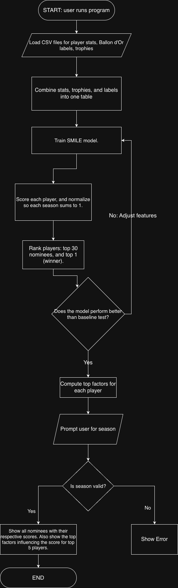

# Ballon d'Or Predictor

A Java application that gives every player from Europe's top five leagues a probability of winning the Ballon d'Or each season, and shows which factors contributed to each score.

## The Problem

The Ballon d'Or is soccer's most prestigious award meant to go to the best player of the season, but, its criteria are vague, as its unclear how much emphasis voters place the individual stats, the team trophies, or a player's overall story. This leads to fans debating if the winner really deserved it, or some other player did, and these debates are usually based on personal opinion. As a passionate soccer fan, I have always wondered if the award really goes to the best player or the best story, but there is no clear way to find out.

## How It Works

The program loads CSV files (player stats, Ballon d'Or results, and team-level trophies), joins them into one table with a row per player per season, and trains a model on earlier seasons. It then scores each player's chance of winning, ranks them (the top 30 are the predicted nominees, top 1 is the predicted winner), and it shows the top factors behind each score. The model is tested on seasons it never saw and compared against a simple baseline, which will be the top 30 by goals + assists.



## Tech Stack

- **Language:** Java
- **Libraries:** SMILE (machine learning), Jackson (JSON parsing), Apache Commons CSV
- **Build tool:** Maven or Gradle
- **Data:** local CSV files in `data/`

## Setup

> TODO: do after project is done.

```bash
git clone https://github.com/anirudhh-sriram/cs193-final-project
cd cs193-final-project
```
## Usage

> TODO: replace with the real command after project is done.

## Roadmap

- [ ] Build a GUI for a website
- [ ] Add advanced metrics like xG
- [ ] Account for exceptional players outside the top 5 leagues (e.g., Messi)

## Project Documents

- [Eisenhower Matrix](Eisenhower-Matrix.pdf)
- [System Diagram](System-Diagram.drawio.png)
